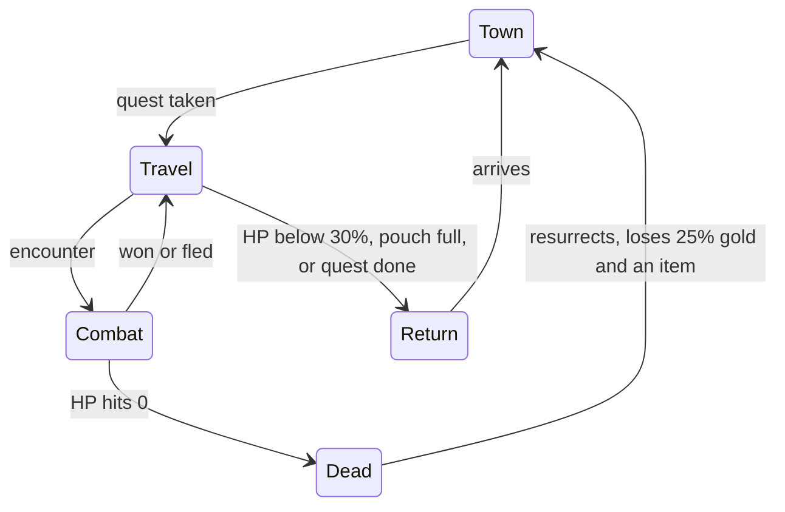

# Godville-like — Game Design Document

Source: https://app.notion.com/p/Godville-like-Game-Design-Document-4058c1dbe2628144bb05e6202b3fe286

Read-only complete recursive export; block anchors retain original identities.

<!-- notion-block: d39d2757-e59f-4e06-8850-2d6c8f04185d type: paragraph -->
2026-10-26 · Final design for the first prototype

<!-- notion-block: f14f2b9f-6f59-426d-9aaf-b9da25d2c86d type: heading_2 -->
## Summary

<!-- notion-block: 433b21df-281f-468e-ad16-37088ea94ae5 type: paragraph -->
A single-player, text-only browser prototype of a Godville-style game where the hero lives on his own and the player, his god, bends the odds of transparent number fights.

<!-- notion-block: ccbf8c1a-455e-4aa2-801f-007faebba563 type: bulleted_list_item -->
- **Core loop**: an autonomous hero quests, fights and loots; the god spends real-time godpower on Blessing, Smite and Voice.

<!-- notion-block: 6f29a6fa-f2d4-4045-9a6f-29d53ced580f type: bulleted_list_item -->
- **Combat**: Loop Hero's 9 stats, 100 ms ticks, deterministic seeded math, and a Monte Carlo win forecast for the god.

<!-- notion-block: 96858d34-4eaa-4a52-a994-24c7c2116990 type: bulleted_list_item -->
- **Loot**: 6 equipped slots and a 10-item bag; one power number drives keep, drop and equip; items stack 1–12 modifiers.

<!-- notion-block: 4639d4f3-9a33-4776-a2dd-1bf6a4045982 type: bulleted_list_item -->
- **World**: one road of towns; difficulty = town base mile + miles walked from that town.

<!-- notion-block: 15c22d13-1eb1-4b58-b4a0-fa91ec67a689 type: bulleted_list_item -->
- **Time**: the world runs at 1× while the god's tab is visible and 0.1× otherwise, with offline catch-up.

<!-- notion-block: a6b1ee73-e6c1-4e42-ab4b-de573c94cd90 type: bulleted_list_item -->
- **Presentation**: no graphics; bars, numbers, a colored combat log and a diary.

<!-- notion-block: a1cbc4d7-ccd1-4e7e-a5ad-5afa299f4a1d type: bulleted_list_item -->
- **Scope**: English with a localization base, all names in CSV files, no server and no MMO.

<!-- notion-block: d97f863c-3989-48a0-a231-d0544fc33fde type: bulleted_list_item -->
- **Stack**: TypeScript, Vite, Preact + signals, a pure simulation package, CSV game data.

<!-- notion-block: a80f060f-c264-4c69-a56a-2e65de686117 type: heading_2 -->
## Vision

<!-- notion-block: d48f77d1-acb4-4441-a1f9-17e047b8f5e0 type: paragraph -->
A text-only, browser-based "zero-player" RPG, single-player first and built to grow into an MMO: your hero lives and fights on his own, and you, his god, nudge him with scarce godpower. The twist on Godville is that every fight is a transparent number duel, so the god's choices are measurable decisions, not just jokes.

<!-- notion-block: 24124428-6feb-4f87-a7f5-2c2283c82737 type: paragraph -->
Pitch: *Godville's soul, Loop Hero's math, a spreadsheet's honesty.*

<!-- notion-block: 449a872b-0f79-4bf8-a57b-faa535119446 type: paragraph -->
Pillars:

<!-- notion-block: 0c3c3b46-82c4-4b5d-b5a4-601073075fe8 type: bulleted_list_item -->
- **The hero acts, the god decides.** The hero chooses what to do; the god spends a limited resource to bend outcomes at the right moment.

<!-- notion-block: 31177c15-a56f-4bcf-9ef3-b0b49b789776 type: bulleted_list_item -->
- **Readable math.** Every number the engine uses can be shown: damage rolls, dodge, crit, win chance, item power. No hidden fudge.

<!-- notion-block: b2692a14-a937-4225-ba73-3312e969f180 type: bulleted_list_item -->
- **Loot worth reading.** Items stack absurd modifiers, and one power number keeps every decision simple.

<!-- notion-block: 4d8246bd-f061-4032-a644-d524da34ba13 type: bulleted_list_item -->
- **Time-quantized real time.** Fights run in fixed ticks, like Loop Hero, so they feel live yet are fully deterministic and replayable.

<!-- notion-block: 3240ba4d-51ae-4fb1-9008-d431128d30cf type: bulleted_list_item -->
- **Zero graphics.** Bars, numbers, a combat log and a diary. Flavor comes from writing, not art.

<!-- notion-block: 9051a3d8-32f5-4a0d-9d62-048e1d707b21 type: bulleted_list_item -->
- **Client-only first, server later.** One simulation engine that runs identically in a browser tab now and on a server later.

<!-- notion-block: d7756238-e55b-4684-9fd1-63ad354c4d54 type: heading_2 -->
## What we take from Godville, and what we drop

<!-- notion-block: fea9c4c9-2f1c-4f85-9404-f4f673c66084 type: paragraph -->
We keep Godville's core loop almost untouched and replace only its combat. In Godville the god cannot control the hero directly; he rewards or punishes him and can send messages the hero may or may not understand, while the hero writes a diary of what he does ([Wikipedia](https://en.wikipedia.org/wiki/Godville)). Godpower is a 0–100% meter spent on those actions; a message costs about 5% and an encourage or punish about 25% ([AppleVis forum](https://www.applevis.com/comment/73394)). The long-term goal is a temple built from gold bricks ([TV Tropes](https://www.tvtropes.org/pmwiki/pmwiki.php/VideoGame/Godville)).

<!-- notion-block: c5d71a01-b9a9-4a2b-9acb-49071fabb20f type: table -->
| Godville feature | Our version | Phase |
| --- | --- | --- |
| Autonomous hero, quests, town visits | Same, as a simple state machine | Prototype |
| Diary (hero's text feed) | Same, templated lines plus combat summaries | Prototype |
| Godpower 0–100% | Same, with accumulator charges | Prototype |
| Encourage / Punish | Blessing (heal) and Smite (damage), numeric | Prototype |
| Voice of god | Fixed keyword commands with an obey chance | Prototype |
| Text-based monster fights | Replaced by tick-based stat combat | Prototype |
| Gold, loot, selling in town | Same, plus Loop Hero stats and stacked modifiers | Prototype |
| Temple of gold bricks | God progression goal | Phase 2 |
| Pet | Third combatant with its own stat block | Phase 3 |
| Arena duels, guilds, newspaper | Deferred until after the prototype | Not planned |
| Ark, retirement, idea box, activatable items | Dropped for now | Later |
<!-- notion-block: a6d30a26-53c6-4671-a880-ef938a7dd327 type: table_row -->
<!-- notion-block: d0931f38-63f1-4967-8e44-4334015932ba type: table_row -->
<!-- notion-block: 788e4fa2-d913-4657-a490-2320563e8bfb type: table_row -->
<!-- notion-block: 10947942-f629-411e-8c54-e36e12add602 type: table_row -->
<!-- notion-block: e1c2065b-43db-4d72-8171-173c70e19f5f type: table_row -->
<!-- notion-block: 4bc73f6a-201f-4a62-8217-1fb6f8df78f9 type: table_row -->
<!-- notion-block: 3182e0be-d1ac-4b3d-8126-6ecad71c3d85 type: table_row -->
<!-- notion-block: 59ad0aa7-4fd8-4b96-b66c-28e7fdb84df2 type: table_row -->
<!-- notion-block: c43349d8-bf2f-4f49-a432-1c55f4e9b460 type: table_row -->
<!-- notion-block: 0bb7d70b-5e10-4b51-804c-49f65a7386e0 type: table_row -->
<!-- notion-block: 85c29d96-7538-43d0-97fc-19eff9575a13 type: table_row -->
<!-- notion-block: 958e85b3-b9bf-4490-96c8-94b47481dfe4 type: table_row -->

<!-- notion-block: 1f55e96a-d6e7-4ed5-bc4b-1af26b88aa4c type: paragraph -->
What we drop on purpose: Godville's comedy depends on a huge community-written phrase base. We cannot match that early, so our humor budget goes into a small set of strong diary templates, and the numbers carry the rest.

<!-- notion-block: 7ab71a5e-4e2f-45cf-ac50-7f24102b7ec4 type: heading_2 -->
## The god (the player)

<!-- notion-block: f6e3ae39-db30-4edb-b500-d56e79584571 type: paragraph -->
The player is a god with his own small stat sheet, not just a remote control. The hero is the god's main worshipper; the god's power grows with the hero's faith.

<!-- notion-block: 0055039a-fcb0-4e21-a463-c98c4a3be0f7 type: paragraph -->
**Godpower (GP).** A 0–100 meter. Regenerates +1 per 6 real minutes (full in 10 hours), always in real time, independent of game speed. Excess can be banked as accumulator charges (100 GP each, max 3 in the prototype).

<!-- notion-block: 1c2487ce-da93-4907-b240-bc7f513881dd type: paragraph -->
**Interventions**

<!-- notion-block: f9a2df0e-78c8-49ce-9264-2ab3defd9785 type: table -->
| Action | Cost | In combat | Outside combat |
| --- | --- | --- | --- |
| Blessing (encourage) | 25 GP | Heal hero 25% of max HP | Heal 25% and +1 good alignment |
| Smite (punish) | 25 GP | Deal 20% of enemy max HP; ignores defense and evasion | Hero loses 10% HP, gains +5% quest progress, +1 evil alignment |
| Voice | 5 GP | Keyword command, may be ignored | Keyword command, may be ignored |
<!-- notion-block: cda7e1e5-7fde-4ff6-a06c-6529e794f852 type: table_row -->
<!-- notion-block: 1ab15470-7202-4ac8-84f4-bc76411d2aae type: table_row -->
<!-- notion-block: dceef772-f475-4513-9d85-6ef60fdc26c4 type: table_row -->
<!-- notion-block: 6f71993c-f644-45fc-bfdb-5c5f042eba07 type: table_row -->

<!-- notion-block: e03038d2-764a-4b29-a660-f61bcec0519b type: paragraph -->
Voice keywords for the prototype: `fight`, `flee`, `rest`, `town`, `dig`. Obey chance = 30% + the god's Clarity stat. Everything else typed is ignored; later it can feed the diary ("I heard a voice saying something about cheese").

<!-- notion-block: 9c2a7b79-cb87-4870-bd54-2f0a87ee4f3e type: paragraph -->
**The god's own stats** (bought with Faith, see Progression):

<!-- notion-block: 27705520-0658-49a0-971a-099abdc23f8d type: bulleted_list_item -->
- **Capacity**: max GP above 100.

<!-- notion-block: abe31897-1297-480b-a416-2518b47c95f0 type: bulleted_list_item -->
- **Flow**: GP regeneration speed.

<!-- notion-block: a7090b23-765f-415b-ac51-23ca9803c3e6 type: bulleted_list_item -->
- **Miracle power**: multiplies Blessing and Smite strength.

<!-- notion-block: fbc83d50-63d5-4131-acd9-db3fda321690 type: bulleted_list_item -->
- **Clarity**: bonus to Voice obey chance.

<!-- notion-block: fafbb9b7-3142-47e1-9bd1-67dfd5e46a17 type: heading_2 -->
## The hero

<!-- notion-block: a8119c27-fb27-4e32-a1ec-da7f687a25c8 type: paragraph -->
The hero is a simple state machine on one long road. Towns sit at fixed miles from Godville, the starting town; the hero works out of one town at a time and wanders away from it. The further from Godville in total, the stronger the monsters and the better the loot. The god never moves him directly.

<!-- notion-block: 31e6a0a2-045d-4971-9099-e5c6076a231c type: code -->


<!-- notion-block: 524d1893-e0e6-4f34-b237-01c4a9e451a7 type: paragraph -->
Combat is the only state where the god's numbers matter minute to minute; the rest of the loop runs itself.

<!-- notion-block: df2dc103-eed7-4aa1-9344-35f22382e8d7 type: paragraph -->
**States**

<!-- notion-block: 423aff5b-350d-49f3-a09d-590566996a0d type: bulleted_list_item -->
- **Town**: sell the weaker half of the bag and all trophies, buy one item if affordable, heal to full, take a quest.

<!-- notion-block: a43598f2-7a7f-4487-ae7c-85ede0a2d5f4 type: bulleted_list_item -->
- **Travel**: walk out at a fixed pace; each step rolls for an encounter, a find (gold, item, brick) or a diary line.

<!-- notion-block: 70ca6883-5baa-4ee6-8c37-7c3b63baaaf1 type: bulleted_list_item -->
- **Combat**: tick-based fight against one monster (multi-monster fights in Phase 2).

<!-- notion-block: 32e31d86-e12f-4ac3-90c1-4b6cea91a360 type: bulleted_list_item -->
- **Return**: walk back when HP is below 30%, the trophy pouch is full or the quest is done.

<!-- notion-block: 28fe6d85-1949-458f-8c1d-59222b945517 type: bulleted_list_item -->
- **Dead**: lie on the road for a timeout, then resurrect in the current town, losing 25% of gold and one random equipped item (god-blessed items are spared).

<!-- notion-block: 322fc1f7-d9fc-4f36-b9e2-85776af4f0b2 type: paragraph -->
**World and difficulty.** Enemy strength depends on the town the hero works from *and* how far he has walked from it:

<!-- notion-block: f1a34067-59b6-400c-a9f8-c128cd40921a type: equation -->
$$
L = \left\lceil \frac{\text{town base mile} + \text{miles from that town}}{10} \right\rceil
$$

<!-- notion-block: 870c7579-f6c6-4890-bacb-8c7802cfb695 type: paragraph -->
L is the zone level used for monsters and for the item level of loot. The hero always walks away from Godville. When his level reaches the next town's minimum, he finishes his current quest and moves his base there (one diary line). Starting values, kept in `towns.csv`:

<!-- notion-block: df8e6cfe-5317-4e50-a61c-62b1dde2ccfb type: table -->
| Town | Base mile | Hero moves here at level |
| --- | --- | --- |
| Godville | 0 | 1 |
| Tradeburg | 50 | 10 |
| Beerburgh | 120 | 20 |
| Godvillewood | 200 | 30 |
<!-- notion-block: ca5bb765-600a-4692-8439-227eac8398f3 type: table_row -->
<!-- notion-block: 73a8ccf8-5c9a-40c7-a387-526161bbc349 type: table_row -->
<!-- notion-block: 2447b3a4-3342-4ac6-96c7-b5c8771cd947 type: table_row -->
<!-- notion-block: e8aa473e-adea-4bf0-a7a3-f50421437339 type: table_row -->
<!-- notion-block: 145900f0-8379-42e7-a372-6b1714a6bfa0 type: table_row -->

<!-- notion-block: 1fce4dfb-565f-45fe-834e-a5d2afdef777 type: paragraph -->
**Decisions the hero makes on his own**

<!-- notion-block: 641fcc04-847a-4db6-80fd-74d0d97a472c type: bulleted_list_item -->
- *Fight or flee*: before each fight he estimates his win chance (see Combat). He flees below his Courage threshold; flee succeeds with 50% + his evasion.

<!-- notion-block: 25dcd16f-e480-473d-a14f-251b9104a68b type: bulleted_list_item -->
- *Equip*: he goes by item power, bent by a few quirks (see Loot, inventory and modifiers). The god sees true power next to the hero's perceived power and can *Bless an item* (5 GP) so the hero prefers it. This is deliberate: the hero is dumb, the god is the mathematician.

<!-- notion-block: e8248695-8b71-4132-928a-f0a796de0119 type: bulleted_list_item -->
- *Go home*: by the HP and pouch thresholds above.

<!-- notion-block: dc700b13-fe3e-4cd1-bd51-5083dcb38931 type: paragraph -->
**Personality.** Alignment (good ↔ evil) moves with Blessings and Smites. Good heroes flee earlier and share loot in town; evil heroes fight longer and steal from corpses. Courage is a number, so the god can learn it.

<!-- notion-block: 933460e1-95b6-4ff8-b7c8-eac5f99ba929 type: paragraph -->
**Diary.** Every state change and notable roll writes one templated line. Combat writes a one-line summary; the full tick log is only shown live or in a replay.

<!-- notion-block: b1a68234-3cee-404a-8180-e38d9f25d517 type: paragraph -->
**Quests.** One active quest with a 0–100% progress bar, advanced by kills and miles walked. Completion pays gold, XP and Faith. Quest names come from templates.

<!-- notion-block: 91efd02c-ab03-4904-95e6-5f8ee592b1ac type: heading_2 -->
## Stats and items

<!-- notion-block: 0ca23e37-7ece-46ac-9ee7-60bde9647f11 type: paragraph -->
We use Loop Hero's stat set: nine stats in the prototype, two more once fights can have several enemies. Definitions follow Loop Hero: evasion and counter are % chances, vampirism returns a % of damage dealt as HP, and Damage to All hits every enemy each attack ([Gfinity](https://www.gfinityesports.com/article/loop-hero-classes-how-to-unlock-warrior-rogue-and-necromancer-explained)). In Loop Hero 1 defense removes 1 damage per hit with a minimum-damage floor, and magic damage ignores defense ([gameplay.tips](https://gameplay.tips/guides/9989-loop-hero.html)).

<!-- notion-block: 6a6d4711-3fad-498d-992f-47f98236eefe type: table -->
| Stat | Unit | Effect | Hero base | Cap | Phase |
| --- | --- | --- | --- | --- | --- |
| Max HP | points | Health pool | 100 | none | Prototype |
| Damage | min–max | Rolled uniformly per hit | 4–6 | none | Prototype |
| Attack speed | % | Interval = 1.5 s ÷ (1 + AS) | 0% | +200% | Prototype |
| Defense | points | −1 damage per point per hit, with a floor | 0 | none | Prototype |
| Crit chance | % | Hit deals ×2 | 0% | 50% | Prototype |
| Evasion | % | Incoming hit misses | 0% | 60% | Prototype |
| Regeneration | HP/s | Applied every tick, in and out of combat | 0.5 | none | Prototype |
| Vampirism | % | Heal that share of damage dealt | 0% | 30% | Prototype |
| Counter | % | When hit, strike back instantly | 0% | 40% | Prototype |
| Damage to All | points | Hits every enemy on each attack | 0 | none | Phase 2 |
| Magic damage | points | Extra hit that ignores defense | 0 | none | Phase 2 |
<!-- notion-block: 11587314-2a58-47c0-92a1-b21981cc0112 type: table_row -->
<!-- notion-block: 673e00f8-e60d-452f-a3b1-696c51c2e6f2 type: table_row -->
<!-- notion-block: c29fcf55-f2a0-4abf-9435-869b10dca895 type: table_row -->
<!-- notion-block: 30ece959-55d2-4fd2-9b91-834f2bbf3253 type: table_row -->
<!-- notion-block: 48d61337-e0cb-4ff1-a719-c46729bd1c43 type: table_row -->
<!-- notion-block: 7522e10b-bb8f-473e-adb6-eb2cb84e72ac type: table_row -->
<!-- notion-block: 6b49f6d1-287b-413c-a6a5-9c302d28a7db type: table_row -->
<!-- notion-block: d74f45c1-36ba-46ce-91c2-d06d5fe26605 type: table_row -->
<!-- notion-block: f8d80831-1c14-44c9-985d-62caad4b2e75 type: table_row -->
<!-- notion-block: 0e1f4dfe-465d-4345-813e-d6f3b09468b7 type: table_row -->
<!-- notion-block: f496306a-799d-43c4-8e83-21a630738b4e type: table_row -->
<!-- notion-block: d1ec7376-bfb9-4a06-ab1e-72dd36fe8fca type: table_row -->

<!-- notion-block: 8536e89c-32cd-4646-bd43-acb1540a4a30 type: paragraph -->
Caps keep the math stable; tune them with simulation.

<!-- notion-block: 70c73388-f7a8-43c5-98f6-c68d8e5493dd type: heading_2 -->
## Loot, inventory and modifiers

<!-- notion-block: 16bdef4f-4349-4673-b42f-69b125a4b41b type: paragraph -->
Every item is a base type plus a stack of modifiers, and one number, **power**, drives every keep, drop and equip decision. Early items carry 1–3 modifiers; endgame items carry up to 12, so a "Legendary Legendary Epic Bad Cursed Torn Worn Expensive Ring of Justice of Vampirism from Far Lands" is a normal drop.

<!-- notion-block: 955d27b7-ba36-4b15-a7b7-c51e7866baad type: paragraph -->
**Inventory.** 6 equipped slots, a bag of 10 gear items, and a separate trophy pouch of 10 for Godville-style junk that only sells for gold (trophies have no power and never compete with gear).

<!-- notion-block: e59a424e-bb8b-4c40-afa9-ce2b56ca8d82 type: paragraph -->
**Power** is the weighted sum of an item's stats. Weights are set so one standard modifier is worth 10 power. Negative stats subtract; price modifiers do not change power.

<!-- notion-block: 0968c213-7dc8-4e66-baa7-83758f49cd92 type: table -->
| Stat | Power per unit | Standard modifier (10 power) |
| --- | --- | --- |
| Max HP | 1 per HP | +10 HP |
| Damage | 5 per point of average | +2 |
| Attack speed | 2.5 per % | +4% |
| Defense | 5 per point | +2 |
| Crit chance | 5 per % | +2% |
| Evasion | 5 per % | +2% |
| Regeneration | 33 per HP/s | +0.3 HP/s |
| Vampirism | 6.7 per % | +1.5% |
| Counter | 5 per % | +2% |
<!-- notion-block: 51ea27b7-7ab9-43c9-bda8-4fb23dbb5b8a type: table_row -->
<!-- notion-block: 409ad2e0-b09a-4dbc-b7b1-7f0df66ca77f type: table_row -->
<!-- notion-block: 22580596-d8d0-410f-9932-b321fe18cd8a type: table_row -->
<!-- notion-block: bc18de62-732d-4e74-ab43-9dcc29690a64 type: table_row -->
<!-- notion-block: a8461785-e2a8-4238-a37b-8dc74c940864 type: table_row -->
<!-- notion-block: 823589fb-2112-4863-a7f1-92a13c5c8f39 type: table_row -->
<!-- notion-block: f3dd6a01-f407-45bd-9051-05658ee5ab19 type: table_row -->
<!-- notion-block: 49dfff24-8e81-4f96-a372-1c88b46de87b type: table_row -->
<!-- notion-block: 5dcf76ee-7627-4881-afd1-9ed9416614e6 type: table_row -->
<!-- notion-block: 7aa1d132-cfe0-4b5f-bf32-542b8c4deb9a type: table_row -->

<!-- notion-block: 449c6cfd-c036-4145-83f3-3295696484eb type: paragraph -->
**The hero's bag rules**

<!-- notion-block: 8b59dcda-afc8-451e-8b0a-546ea6cf7ee0 type: numbered_list_item -->
1. *Pick up*: if the bag has space, take the item. If it is full, take it only if its power beats the weakest bag item, and drop that one (with a diary line).

<!-- notion-block: 4834604c-fbdb-4f56-8378-04ded77636ec type: numbered_list_item -->
1. *Equip*: after each pickup and in town, for each slot, if a bag item's perceived power beats the equipped item by 5% or more, swap. The old item goes to the bag under rule 1.

<!-- notion-block: 98aee115-309f-4312-9028-ea0f3c83d4c3 type: numbered_list_item -->
1. *Sell*: in town, sell the weaker half of the bag and every trophy. God-blessed items are never sold or dropped.

<!-- notion-block: 92d44888-2eb7-46b5-b12e-9959eb766536 type: paragraph -->
"Mostly by power" comes from **perceived power** = power × the hero's quirks:

<!-- notion-block: e17c6268-9ea1-4111-be6f-4c387e43ab5c type: bulleted_list_item -->
- *Alignment*: good heroes see Cursed and Heretical items at ×0.7; evil heroes at ×1.3.

<!-- notion-block: b01412d4-42ca-4088-a2c2-4c56f61e004e type: bulleted_list_item -->
- *Favorite word*: each hero gets one at creation (for example Golden); items carrying it count ×1.25.

<!-- notion-block: 749a5d8b-07d7-4948-bea3-382937473a8d type: bulleted_list_item -->
- *God's blessing* (5 GP): ×1.5 and the item is locked.

<!-- notion-block: e7624e44-ff75-4a9e-90cc-ad4a1b5d1155 type: paragraph -->
The god's panel shows true power next to perceived power, so the god can see when the hero is being silly.

<!-- notion-block: ce8007f2-9a1a-47a3-a06e-8772edcf2659 type: paragraph -->
**Slots and base items.** Every slot has base power 20 at item level 0. Item level L = the zone level where it dropped; every value scales by (1 + 0.15 L).

<!-- notion-block: e827a5f1-de35-4645-96c1-9b5237999019 type: table -->
| Slot | Base stats at level 0 | Example base names |
| --- | --- | --- |
| Weapon | Damage 3–5 | Sword, club, frying pan, umbrella |
| Helmet | Defense 2, Max HP 10 | Helmet, pot, wizard hat |
| Armor | Max HP 20 | Chainmail, bathrobe, barrel |
| Shield | Defense 4 | Shield, door, pizza lid |
| Ring | One random standard modifier, doubled | Ring, signet, nut |
| Amulet | Two different random standard modifiers | Amulet, lucky tooth, medal |
<!-- notion-block: af4d4810-44ec-4098-b370-00dcdd7cc788 type: table_row -->
<!-- notion-block: e828d42a-bf06-4346-a1cb-625117fafeb7 type: table_row -->
<!-- notion-block: 150ba4aa-56fe-4ee1-9e4a-7274de6b1d31 type: table_row -->
<!-- notion-block: dd4d5049-ef80-41ac-9a16-266bc3f40d79 type: table_row -->
<!-- notion-block: 3e4cebee-c269-4362-8e1a-2e13deb0b828 type: table_row -->
<!-- notion-block: 82a550de-8c72-442f-bb1d-bd5042c6e526 type: table_row -->
<!-- notion-block: c2489894-76a9-4494-9f13-bd45369dafff type: table_row -->

<!-- notion-block: 60405b32-bef4-47a3-abf6-4d2c9b29b314 type: paragraph -->
**How many modifiers**, rolled with low counts more likely:

<!-- notion-block: fda505f0-fc86-46f6-b23f-11f379411651 type: table -->
| Stage | Zone level | Modifiers per item |
| --- | --- | --- |
| Early | 1–5 | 1–3 |
| Mid | 6–15 | 3–6 |
| End | 16+ | 6–12 |
<!-- notion-block: fb12987a-3243-422d-9b74-6068b2217352 type: table_row -->
<!-- notion-block: 3cb3910f-b23b-4f6e-96a4-f1a471ddcae3 type: table_row -->
<!-- notion-block: 74007d66-d567-45e6-a306-8926d9413387 type: table_row -->
<!-- notion-block: 9369b441-e658-4a01-86e4-1c7bebccf51e type: table_row -->

<!-- notion-block: 50bc9f38-fb48-4b7c-b7a5-5eb485a5c830 type: paragraph -->
Duplicates are allowed and stack: two Legendary prefixes give ×2.25.

<!-- notion-block: 1c51f4c5-3f85-4386-8b0e-a9bce52c0b2d type: paragraph -->
**Building an item** (the order matters for the math):

<!-- notion-block: 67f5855a-5f80-420e-87b3-d98d687874be type: numbered_list_item -->
1. Roll the base type and item level.

<!-- notion-block: 1bb0720b-9d27-4814-ade9-6235fefa0e42 type: numbered_list_item -->
1. Roll the modifier count, then draw modifiers by weight; each has a minimum zone level.

<!-- notion-block: 9d190ea8-9d5e-46e5-afa8-2e897112540d type: numbered_list_item -->
1. Add flat stats from stat modifiers.

<!-- notion-block: c30ab947-0f2a-4f97-9486-ae80db8d4005 type: numbered_list_item -->
1. Multiply every stat by the product of all multipliers.

<!-- notion-block: ff370060-b215-45bc-8d0b-9848fb07453b type: numbered_list_item -->
1. Apply curses: each Cursed adds one negative stat from Max HP, Damage, Defense, Attack speed or Regeneration, sized 1.5 × a standard modifier × the level scale.

<!-- notion-block: a98e0acb-342f-477b-b856-18c4979b0e2e type: numbered_list_item -->
1. Compute power, then price = power × 2 × every price multiplier.

<!-- notion-block: 933890d9-6579-4020-ac7a-dc2bbd98396f type: numbered_list_item -->
1. Render the name in the player's language (see Localization).

<!-- notion-block: a3115486-fd77-46d4-a7db-e4f541b1134e type: paragraph -->
**Modifier catalog** for the prototype. Name order is fixed by group: quality, morality, condition, economy, base, "of …", "from …"; within a group, roll order.

<!-- notion-block: de66ce0f-af73-4337-b537-19bec9d84dcc type: table -->
| Modifier | Group | Effect | Min zone |
| --- | --- | --- | --- |
| Shoddy | Quality | ×0.7 all stats | 1 |
| Fine | Quality | ×1.1 all stats | 1 |
| Epic | Quality | ×1.2 all stats | 3 |
| Legendary | Quality | ×1.5 all stats | 8 |
| Divine | Quality | ×2.0 all stats | 16 |
| Bad | Morality | ×0.75 all stats; evil heroes love it | 1 |
| Cursed | Morality | ×1.5 all stats, plus one negative stat | 4 |
| Blessed | Morality | ×1.1 all stats, plus standard Regeneration | 2 |
| Holy | Morality | God's Blessing heals 10% more | 5 |
| Heretical | Morality | ×1.4 all stats; god's miracles 10% weaker | 6 |
| Torn | Condition | ×0.8 all stats | 1 |
| Worn | Condition | ×0.9 all stats | 1 |
| Rusty | Condition | ×0.85 all stats, price ×0.7 | 1 |
| Polished | Condition | ×1.05 all stats, price ×1.2 | 2 |
| Squeaky | Condition | −2% evasion; the hero complains in the diary | 1 |
| Cheap | Economy | Price ×0.5 | 1 |
| Expensive | Economy | Price ×2 | 1 |
| Golden | Economy | Price ×3 | 4 |
| Counterfeit | Economy | Looks Golden in the shop, sells for ×0.1 | 4 |
| of Sharpness | Stat | +Damage | 1 |
| of the Bull | Stat | +Max HP | 1 |
| of Haste | Stat | +Attack speed | 1 |
| of the Turtle | Stat | +Defense | 1 |
| of Precision | Stat | +Crit chance | 1 |
| of the Hare | Stat | +Evasion | 1 |
| of the Troll | Stat | +Regeneration | 1 |
| of Vampirism | Stat | +Vampirism | 1 |
| of Spite | Stat | +Counter | 1 |
| of Justice | Stat | Half a standard Crit plus half a standard Counter | 3 |
| of Everything | Stat | A quarter of every standard modifier | 12 |
| from Far Lands | Origin | One extra random standard modifier, price ×1.5 | 2 |
| from Grandma's Attic | Origin | ×1.1 all stats, price ×0.3 | 1 |
| from Beerburgh | Origin | +Max HP, −Attack speed (the item is slightly drunk) | 3 |
| from Tradeburg | Origin | Price ×1.3 | 1 |
| from the Lost and Found | Origin | Price ×0.5 | 1 |
<!-- notion-block: 8460d812-607a-4624-b07c-dd8d3d96797e type: table_row -->
<!-- notion-block: cba00ba0-1a47-458d-90d2-3a2bc0490586 type: table_row -->
<!-- notion-block: 8e9f2934-6269-4882-bd52-5756f0f40585 type: table_row -->
<!-- notion-block: eb96f890-35bc-4d9d-b687-bbd2c19939b6 type: table_row -->
<!-- notion-block: 5a0010f5-5490-49e5-bad6-505d01c656c4 type: table_row -->
<!-- notion-block: fcc806b8-ef76-423a-b571-589e726ad771 type: table_row -->
<!-- notion-block: b38ea175-d2f6-4c87-9159-dc4ac58f8cac type: table_row -->
<!-- notion-block: 8d4c3c00-cd5e-42ba-8c57-ecf7c9c3e7a6 type: table_row -->
<!-- notion-block: c7b4097d-1e01-43e9-957d-e451a7ac6655 type: table_row -->
<!-- notion-block: b78259cd-e953-437b-b619-e615cb839889 type: table_row -->
<!-- notion-block: ed85f630-30e4-4c3e-b30f-24e093e35fa0 type: table_row -->
<!-- notion-block: 2f362d85-753d-4600-b8a3-326d69e1e0d5 type: table_row -->
<!-- notion-block: 0137f3fb-8fb7-4ec7-8c77-5de67661a9dc type: table_row -->
<!-- notion-block: a3bb40e9-2b64-4cae-a759-3ff40f50ac07 type: table_row -->
<!-- notion-block: 5570a862-8393-43e8-aac9-2a2710db03b1 type: table_row -->
<!-- notion-block: 4606cad2-11cd-4857-960c-cef8ed63dbf4 type: table_row -->
<!-- notion-block: ed2215d2-0fd3-4d97-9b6f-a216be17df18 type: table_row -->
<!-- notion-block: ceeca542-dc40-4915-8ae2-9e67a91cc512 type: table_row -->
<!-- notion-block: d494d0b1-efa5-437f-b867-f215c4fe5f1b type: table_row -->
<!-- notion-block: 4942ba23-f48b-498f-bfe0-5b14200829b5 type: table_row -->
<!-- notion-block: 4b6f8d74-77f5-4289-a2a1-6cfe08775624 type: table_row -->
<!-- notion-block: 43ca265a-b782-4066-9e4c-d5d838ae03a8 type: table_row -->
<!-- notion-block: 53c418e6-8aec-4e72-98d3-4c21e242c889 type: table_row -->
<!-- notion-block: 51348488-ba18-4e49-9504-cec28d9b650a type: table_row -->
<!-- notion-block: 928f96a0-ee13-4d86-82e8-ef99fd382895 type: table_row -->
<!-- notion-block: 439012dd-fa12-4df1-bd83-9d2bb82c4305 type: table_row -->
<!-- notion-block: 0e8f35ff-028e-4b0b-9c8f-271442876316 type: table_row -->
<!-- notion-block: 24cf81a3-200a-4173-b9e6-c86c2ac1f616 type: table_row -->
<!-- notion-block: 7f1a366f-db29-4ef0-bf1b-55e120ca779c type: table_row -->
<!-- notion-block: 8ae9a542-ecb3-4ced-934f-408057e89de7 type: table_row -->
<!-- notion-block: 3d84a3c7-8042-47c8-8fb4-a3dc1afccef4 type: table_row -->
<!-- notion-block: f28baf8e-62c5-44d5-a375-73926b87fe35 type: table_row -->
<!-- notion-block: ec1f4ec9-64e4-4285-a5b7-be48fd957b99 type: table_row -->
<!-- notion-block: 36ba6a87-a99d-4e55-bc7a-3ed9cd7cdf45 type: table_row -->
<!-- notion-block: 8d4903f3-62b9-4942-bd79-abde06085b4e type: table_row -->
<!-- notion-block: be7d2543-37b7-4d23-bdc7-d86b4a8399a9 type: table_row -->

<!-- notion-block: 38f6551c-5273-47a3-beed-150ed3cca025 type: paragraph -->
**Worked example**, zone 20 (level scale ×4): *Legendary Legendary Epic Bad Cursed Torn Worn Expensive Ring of Justice of Vampirism from Far Lands*.

<!-- notion-block: 9efac69d-8f08-4cf8-ab6b-59179f0d1d56 type: bulleted_list_item -->
- Base ring rolled Crit: 2% doubled = 4%, scaled to 16%.

<!-- notion-block: 63e9f647-6990-471a-a38b-fbe7861c30eb type: bulleted_list_item -->
- of Justice: +4% Crit, +4% Counter. of Vampirism: +6%. from Far Lands rolled Max HP: +40.

<!-- notion-block: 107c2ed0-8a39-4cea-85ab-53669700c6c3 type: bulleted_list_item -->
- Multipliers: 1.5 × 1.5 × 1.2 × 0.75 × 1.5 × 0.8 × 0.9 = 2.187.

<!-- notion-block: d1a325db-e96d-4620-a0b6-c55d12b73744 type: bulleted_list_item -->
- Result: Crit 43.7%, Counter 8.7%, Vampirism 13.1%, Max HP 87. The curse rolled Regeneration: −1.8 HP/s.

<!-- notion-block: c9e54a3e-2622-46f5-bce1-41f4b3b39943 type: bulleted_list_item -->
- Power ≈ 377, against 80 for a plain zone-20 ring. Price ≈ 2,260 gold (Expensive ×2, Far Lands ×1.5).

<!-- notion-block: c32a6b28-32f6-4900-844e-b64b503669c7 type: paragraph -->
Hero caps (Crit 50%, Evasion 60% and so on) apply to totals, never to items, so items can be absurd and fights stay sane.

<!-- notion-block: 9bb88e38-afa3-40c8-836d-7a9879a7514f type: paragraph -->
**Display.** Names can run past 15 words, so every item has two forms: the full name (wraps, never cut) and a compact one, *Legendary×2 Epic … Ring of Justice +4*, with the full name on hover or tap. Name color comes from power ÷ the base power for that slot and level: under 0.9 grey, 0.9–1.2 white, 1.2–1.6 green, 1.6–2.2 blue, 2.2–3.5 purple, above 3.5 orange.

<!-- notion-block: 082d2298-6054-4b02-bd4b-83f80f1832d1 type: heading_2 -->
## Combat model

<!-- notion-block: 9287fade-08a9-46f7-adbc-5dd1cd74a742 type: paragraph -->
Combat is a deterministic simulation in fixed 100 ms ticks of game time, driven by a seeded random generator. The same seed and the same two stat blocks always produce the same fight, so a later server can trust it and the client can replay it.

<!-- notion-block: d19db7d8-f3ed-469e-ac86-7ed541f7e67a type: paragraph -->
**Attack timing.** Each combatant has an attack bar that fills every tick. When it reaches the interval, it attacks and the bar resets, keeping the overflow. Loop Hero's base cycle is about 1.5 s between attacks ([gameplay.tips](https://gameplay.tips/guides/9989-loop-hero.html)); we use 1.5 s as the base.

<!-- notion-block: bedce587-6f2a-4f2a-848a-c98192a340d3 type: equation -->
$$
\text{interval} = \frac{1.5\,\text{s}}{1 + AS}
$$

<!-- notion-block: af58132b-7819-450c-90e7-69754f128563 type: paragraph -->
**Order of one tick**

<!-- notion-block: b6589602-22eb-47b4-83f6-cd74330d67f7 type: numbered_list_item -->
1. Apply queued god actions (Blessing, Smite) sent during the previous tick.

<!-- notion-block: 322d32fa-2b90-4443-a5e8-acc72ad8c92c type: numbered_list_item -->
1. Apply regeneration: HP += regen × 0.1.

<!-- notion-block: 57d80ca2-2e9c-4d7e-b4bb-ca88a1ecebda type: numbered_list_item -->
1. Advance both attack bars by 0.1 s.

<!-- notion-block: ea581826-f08a-486d-a336-5fcf519a7096 type: numbered_list_item -->
1. Resolve every attack whose bar is full, the fullest bar first (tie: hero first).

<!-- notion-block: 3181e12e-9bbc-4a1a-9b53-17dcace5d533 type: numbered_list_item -->
1. Check deaths; end the fight if either side is at 0 HP.

<!-- notion-block: 8f6b554c-e002-449f-a6d6-76e848b06546 type: paragraph -->
**Resolving one hit**

<!-- notion-block: fd3bfc00-66e0-4079-a98c-768cac36c094 type: numbered_list_item -->
1. Evasion roll by the defender. Success logs `DODGE` and ends the hit.

<!-- notion-block: af2657d0-3d67-457e-ba6b-cad8d8bcc8d1 type: numbered_list_item -->
1. Damage roll: uniform integer between min and max.

<!-- notion-block: 0b895747-6f5b-462c-89b9-7b908a6b9c1c type: numbered_list_item -->
1. Crit roll by the attacker: ×2, logged `CRIT`.

<!-- notion-block: edf868e2-8354-41c9-b194-cc5ea0aefe48 type: numbered_list_item -->
1. Defense, with a 20% floor so nothing becomes immune: dealt = max(⌈0.2 × raw⌉, raw − DEF).

<!-- notion-block: c591fbd5-baba-4dc6-bfdf-3f346d4f5c5d type: numbered_list_item -->
1. Attacker heals dealt × vampirism.

<!-- notion-block: 2eb56f6d-1f98-4bed-acf8-37902954cbb0 type: numbered_list_item -->
1. Counter roll by the defender, if it survived: an immediate extra hit (steps 1–5), which cannot itself be countered. Logged `COUNTER`.

<!-- notion-block: 8cda4a73-3628-4685-b269-55c88aec4967 type: paragraph -->
**Monsters** use the same stat block. Starting formulas for zone level L (defined in The hero, World and difficulty), to be tuned by simulation:

<!-- notion-block: a09f3ec8-28d5-487d-8952-38ba81c33adb type: table -->
| Stat | Formula |
| --- | --- |
| Max HP | 40 + 18L |
| Damage | (3 + 1.5L) to (5 + 2.5L) |
| Interval | 1.2–2.4 s, by family |
| Defense | 0.6L |
<!-- notion-block: 5067e27f-c53f-4ce8-bab7-5e64457403f9 type: table_row -->
<!-- notion-block: 084b5b4e-3bfb-484e-b7c9-356dacb0c3cf type: table_row -->
<!-- notion-block: 62bae9c9-f1f2-4674-b603-9e0f5efb8797 type: table_row -->
<!-- notion-block: 5065d577-a743-4355-97a7-c77dca835bd8 type: table_row -->
<!-- notion-block: 449d50d2-3d74-4f6c-9a5e-734906e86152 type: table_row -->

<!-- notion-block: d6f1a62e-670b-4fdb-9778-321a91a0179a type: paragraph -->
Each monster family tilts one stat: Spider (fast, weak), Golem (slow, high defense), Wraith (evasion), Leech (vampirism), Brute (crit). Names and flavor are just text on top.

<!-- notion-block: bf92708c-c029-451b-bec9-74cbd1e64c6a type: paragraph -->
**Win forecast.** Two tools, on purpose:

<!-- notion-block: 82c8e836-5d85-47e6-82a9-5da6037f36e3 type: bulleted_list_item -->
- The *hero* uses a cheap closed-form estimate to decide fight or flee: compare his time-to-kill with the monster's, using expected damage per second.

<!-- notion-block: 362ecd40-febb-41f3-891c-9d67df8f9c50 type: bulleted_list_item -->
- The *god* sees a Monte Carlo forecast: 200 simulated fights from the current state, recomputed every second while watching, shown as "Win 62%". This is the decision tool for when to spend 25 GP.

<!-- notion-block: fd43c3c5-4db1-46d2-8c5f-925cf72dfdc0 type: equation -->
$$
\text{EDPS}_A = \frac{1 + AS_A}{1.5} \cdot (1 - EV_B) \cdot \overline{\text{dealt}}_{A \to B} \cdot (1 + CR_A)
$$

<!-- notion-block: 73185d86-3bde-40f8-91cb-8b35e1c7aeca type: equation -->
$$
\text{TTK}_{A \to B} = \frac{HP_B}{\text{EDPS}_A - \text{regen}_B - \text{EDPS}_B \cdot VAMP_B}
$$

<!-- notion-block: f1114950-d8d2-480e-9d58-734531fb1607 type: paragraph -->
**Balancing method.** Before any content is written, run a headless batch of 10,000 fights per zone level and target: a fresh hero with zone-appropriate gear wins about 85% of fights and ends them with 40–60% HP. The prototype ships with this simulator as a dev page.

<!-- notion-block: 4aa15116-6948-4b68-acd0-a78a9bf91292 type: heading_2 -->
## Time model

<!-- notion-block: 4a00770c-55d5-4186-bdff-918b750af653 type: paragraph -->
A hero lives at full speed (1.0×) while his god's tab is visible and at 0.1× otherwise. In-world this is the **Divine Gaze**: mortals move faster when their god is watching. It rewards attention without punishing absence, which suits an idle game.

<!-- notion-block: 67f6852e-6a32-4c86-bf99-ea3b90eed533 type: paragraph -->
Speed changes the world clock, not the hero. At 0.1× every tick, step and fight simply takes ten times longer in real time; the outcome per game second is identical. Watching a fight never makes the hero stronger, it only lets the fight play out sooner.

<!-- notion-block: 832e78c5-a26f-4189-ad90-2a2ba831589b type: table -->
| Mode | Game speed | When | Combat tick |
| --- | --- | --- | --- |
| Watched | 1.0× | Owner's tab visible | 100 ms real |
| Unwatched | 0.1× | Tab hidden or closed | 1 s real |
<!-- notion-block: 8813d587-a5bb-4915-8bbb-e7633c46a39d type: table_row -->
<!-- notion-block: 39fbe7ba-ef8d-4efe-b08d-da816495bf47 type: table_row -->
<!-- notion-block: f8d9e399-fff4-4fcc-8a74-a9f67c127ba8 type: table_row -->

<!-- notion-block: 92246e7a-dbfe-4ef1-ae8d-7b60a820e79a type: bulleted_list_item -->
- "Visible" uses the browser's Page Visibility API.

<!-- notion-block: 2d422c65-bea0-4f87-8f32-9a8db7e0748b type: bulleted_list_item -->
- Godpower always regenerates in real time, so the god's budget does not depend on staring at the tab.

<!-- notion-block: c68bd52e-2fc9-439c-973f-6c425ffda2cd type: bulleted_list_item -->
- Everything inside a hero's life (travel, fights, quests, death timers) runs in game time.

<!-- notion-block: 165c2f89-4f0f-4395-9e19-71e6a8f340df type: paragraph -->
**Simulating cheaply: lazy catch-up.** A hero that is not on screen is not ticked. We store state, the RNG seed and a timestamp. When the owner opens the tab, the engine fast-forwards elapsed real time × 0.1 of game time in one go. A full offline day is 2.4 game hours, about 86,000 ticks: milliseconds of CPU. This works only because the simulation is deterministic and has no dependence on wall-clock inside a step.

<!-- notion-block: 2b228d26-274f-48d2-a74c-c20b5a0dcd86 type: paragraph -->
**Prototype without a server.** The engine runs in the tab and saves to localStorage with a timestamp. On load it catches up at 0.1× the time away.

<!-- notion-block: 1cf9b8ef-5811-4399-9e11-06a42162e627 type: paragraph -->
**No limit on watching.** There is no idle check and no daily cap: a visible tab counts as watching, and leaving the game open is simply a way to play.

<!-- notion-block: 50eb397f-d38c-4519-b228-b8ad3d3e8d05 type: heading_2 -->
## Presentation

<!-- notion-block: d0f6d6d9-5fed-429a-9811-a9f8414a1693 type: paragraph -->
One page, three columns, no images: hero sheet on the left, live panel in the middle, god panel on the right. Everything is text, bars and colored numbers.

<!-- notion-block: 41be335b-d8e7-4749-9136-1b9cf77bda7a type: bulleted_list_item -->
- **Hero sheet**: name, level, XP bar, HP bar, gold, current town and distance, quest bar, the stat table, equipped items with their numbers, and the 10-slot bag sorted by power.

<!-- notion-block: 36c753fb-539d-45f9-81ab-f1c7b1b992aa type: bulleted_list_item -->
- **Live panel** in combat: two HP bars facing each other, a thin attack bar under each (fills toward the next swing, like Loop Hero), the win forecast, and a scrolling log. Out of combat it shows the diary.

<!-- notion-block: 320ba397-85da-4149-b31a-fd8afd610970 type: bulleted_list_item -->
- **God panel**: GP bar and charges, Blessing / Smite buttons with cost, the Voice input, and the god's own stats.

<!-- notion-block: 18fcbb8b-45fc-49be-b972-9301586ccb81 type: paragraph -->
Events are shown as short colored tokens in the log:

<!-- notion-block: 7aa65cd9-ae51-4dde-9561-570815a0c4b8 type: code -->
```javascript
[00:03.2] Hero → Dust Bunny     −14
[00:04.1] Dust Bunny → Hero     DODGE
[00:04.7] Hero → Dust Bunny     CRIT −31
[00:05.0] Dust Bunny → Hero     −6   (defense −4)
[00:05.0] Hero → Dust Bunny     COUNTER −9
[00:05.3] GOD                   SMITE −52
[00:05.3] Dust Bunny dies. +34 XP, +12 gold, Torn Ring of the Hare (power 23)
```

<!-- notion-block: 88772e4b-970c-44bd-9213-b25f5585f0f5 type: paragraph -->
Color rules: damage dealt white, damage taken red, heals green, dodge grey, crit yellow, god actions violet. Optional: a damage number briefly flashes next to the HP bar it changed. That is the only animation.

<!-- notion-block: 1261c40f-6262-4d80-9064-325db86a0432 type: heading_2 -->
## Writing, names and humor

<!-- notion-block: 8ba957b3-4d52-4319-9445-72d2edb5aae3 type: paragraph -->
Humor carries a game with no graphics, so the prototype uses real Godville names for monsters, trophies and towns, and diary templates that turn numbers into small jokes. Godville's monster and item names are mostly puns ([TV Tropes](https://www.tvtropes.org/pmwiki/pmwiki.php/VideoGame/Godville)), which suits our stacked modifiers well.

<!-- notion-block: 5bbb6b30-966d-45be-bebc-692f08686047 type: paragraph -->
**Monsters by family** (names from the GodWiki [Strong Monsters](https://wiki.godvillegame.com/Category:Strong_Monsters) and [Monsters](https://wiki.godvillegame.com/index.php?title=Category%3AMonsters&pageuntil=Bonfirefly&filefrom=Bionight.jpg) categories and the [Dust Bunny](https://wiki.godvillegame.com/Dust_Bunny) page):

<!-- notion-block: df17ce08-6751-4da9-9e15-71a9df31bb50 type: table -->
| Family (stat tilt) | Godville monsters |
| --- | --- |
| Spider (fast, weak) | Battle Hamster, Dust Bunny, Killer Rabbit, Vorpal Wabbit |
| Golem (slow, high defense) | Dreaded Gazebo, Double Dragon, Bald Mammoth, Bicyclops |
| Wraith (evasion) | Blasphemouse, Black Sheep, Bird of Paralyze, Biowolf |
| Leech (vampirism) | Blood-Sucking Lawyer, Blood Bank Robber, Beerwolf |
| Brute (crit) | Bipolar Bear, Blamethrower, Battlesheep, Battle Toad |
<!-- notion-block: f4417576-4275-4d57-b08d-3bdcdbad1951 type: table_row -->
<!-- notion-block: 063147e5-cb71-447c-b03c-5528eee7a48c type: table_row -->
<!-- notion-block: 0662b418-d363-427d-8c3a-2d13b2a43e08 type: table_row -->
<!-- notion-block: 913826a1-4a98-41d1-83e1-16ca24312949 type: table_row -->
<!-- notion-block: bcd25bad-8ba2-4e02-88f1-96bb8b1b2cf9 type: table_row -->
<!-- notion-block: cd10c3f6-2cdb-4fd9-be3c-1689a3b17e3d type: table_row -->

<!-- notion-block: 15fee724-f695-4157-b512-a765825de132 type: paragraph -->
**Towns**: Godville (start and temple), Tradeburg, Beerburgh and Godvillewood, the towns around the capital in Godville's lore ([Godville Wiki](https://godville.fandom.com/wiki/Godville_(Town))). Tradeburg and Beerburgh also appear as "from …" item origins.

<!-- notion-block: 77d814c2-a3d9-475c-bff7-5aaaea66a3e3 type: paragraph -->
**Trophies** for the pouch (sell-only junk), from the GodWiki [Omnibus List](https://wiki.godvillegame.com/Omnibus_List): Argyle sock puppet, Armor-piercing can opener, Arkitecture for dummies, Buoyant anchor, Buried hatchet, Bunny-shaped bath soap, Burial voucher.

<!-- notion-block: e6283fcc-0b11-42f7-a52e-efabaa7e0cc7 type: paragraph -->
**All names live in CSV data files, never in source code.** Monsters, towns, trophies, item bases and modifiers are rows in files under `data/`, keyed by a stable id; code refers only to ids. Replacing Godville's names with our own is an edit to these files and nothing else. The Godville names are placeholders until then.

<!-- notion-block: da4adcba-ace8-4260-b239-b390dd889bed type: table -->
| File | Columns |
| --- | --- |
| `monsters.csv` | id, family, name_en |
| `towns.csv` | id, base_mile, min_level, name_en |
| `trophies.csv` | id, base_price, name_en |
| `bases.csv` | id, slot, name_en |
| `modifiers.csv` | id, group, position, effect, value, min_zone, weight, name_en |
<!-- notion-block: 0c88fe99-9092-459f-baac-23f0ee7d15f3 type: table_row -->
<!-- notion-block: bfb1dd2f-14aa-4242-982f-ca424831008b type: table_row -->
<!-- notion-block: da75b0f3-7c63-4c1e-b54b-16231d8a6dae type: table_row -->
<!-- notion-block: 2a01a2f0-4d83-4fea-92bf-3948b7c89c65 type: table_row -->
<!-- notion-block: 288add38-61d7-4cb2-b98f-3672c332e227 type: table_row -->
<!-- notion-block: 42f51eb6-33dc-46df-a370-cd57109857ec type: table_row -->

<!-- notion-block: 9ec3881d-190b-49df-9cf8-3a635691cc95 type: paragraph -->
A new language adds a `name_xx` column, plus grammar columns where that language needs them (for example gender on bases, a form per gender on prefixes).

<!-- notion-block: cd8dac12-e2e0-48c9-98e8-2e4789aa3168 type: paragraph -->
**Diary templates.** Each event key has 5–20 variants; a variant is not reused within the last 20 diary lines. Variables are typed (item, monster, town, number) so they can be inflected per language. Our own sample lines:

<!-- notion-block: da979f25-ee93-43ab-b330-6a66bbb99199 type: table -->
| Event | Sample line |
| --- | --- |
| Pick up | Picked up a {item}. Power {power}. Stronger than my worst thing, so I love it now. |
| Drop | Left my {item} by the road. It had {power} power and a good heart. Mostly power. |
| Long-named item | Found a ring with more adjectives than the town herald. It drinks my blood. Keeping it. |
| Equip by quirk | Equipped the {item}. It is weaker, but it is golden, and so am I. |
| Cursed item | My {item} whispers to me at night. Mostly tax advice. |
| Counterfeit sold | The merchant in {town} bit my golden {item} and laughed for a long time. |
| Squeaky item | Snuck up on a {monster}. My {item} squeaked. We both screamed. |
| Long fight | Fought a {monster} for {seconds} seconds. Stopped counting its hits after {hits}. |
| Bipolar Bear | The Bipolar Bear apologized, bit me, then apologized again. |
| Smite | Lightning struck the {monster}. I said thank you. The {monster} said nothing, being ash. |
| Blessing | Felt warm and healed. Either divine grace or I sat on the campfire again. |
| Voice ignored | A voice from above said "{voice}". I decided it meant lunch. |
| Death | Died and lost my {item}. The afterlife queue in {town} is shorter on Tuesdays. |
| Moving town | Packed my {item} and moved to {town}. The monsters there are bigger. So are the pies. |
| Level up | Level {level}! I feel {hpGain} HP smarter. |
<!-- notion-block: 44eea206-7ac9-4382-8b9f-92866767e365 type: table_row -->
<!-- notion-block: f4dd0eff-2b71-4da9-9065-c0dddd6456a5 type: table_row -->
<!-- notion-block: 79744d26-c595-477f-aa74-d02677fce400 type: table_row -->
<!-- notion-block: 7d0f94b2-f86e-4844-a41e-5e12cdc1ecc3 type: table_row -->
<!-- notion-block: 8cadbd55-f086-4076-ac47-35897fd7bee9 type: table_row -->
<!-- notion-block: 1ca94043-560a-463e-8007-1c1429d80f9c type: table_row -->
<!-- notion-block: 33f8cfe7-e0d3-4998-b09d-020f1c16d175 type: table_row -->
<!-- notion-block: 83ef43a1-4095-45e9-9f77-32cff6accf79 type: table_row -->
<!-- notion-block: 6e61d0fb-03ef-4795-91bf-08bf93364183 type: table_row -->
<!-- notion-block: ef2f7189-f2c5-47f8-915c-d34fe2076fd7 type: table_row -->
<!-- notion-block: 12d1b9d6-84a3-46c3-9b81-3c8302bd8b57 type: table_row -->
<!-- notion-block: 69cdc5c3-6cb9-40c8-9065-2cf873d7fed9 type: table_row -->
<!-- notion-block: 049dc32a-21db-4c99-90c5-3aee6e2aa913 type: table_row -->
<!-- notion-block: a0459571-339e-4767-b74d-f0afa834af33 type: table_row -->
<!-- notion-block: acdfc1f3-0979-48c6-9d17-410e0abe0d62 type: table_row -->
<!-- notion-block: 6351fe4d-064f-4c0c-bbcf-827bd511b483 type: table_row -->

<!-- notion-block: 496ceaf5-199c-4909-b9eb-c684e3c49de2 type: heading_2 -->
## Localization

<!-- notion-block: fb1833b2-89fe-4101-bf0e-02b2b57ae91c type: paragraph -->
The prototype ships in English only, but no player-facing text lives in code: every line is a key, every item name is assembled from data, and the diary stores events rather than sentences. Adding a language later means adding files, not rewriting systems.

<!-- notion-block: caf75264-1512-4e39-a4b8-80547f732ece type: bulleted_list_item -->
- **Strings** (UI text and diary templates) live in locale files (`en.json` now) using ICU MessageFormat, so plurals and choices are handled by the format: `{count, plural, one {# dodge} other {# dodges}}`.

<!-- notion-block: 6a97638e-7563-4418-8878-106d3d6d273c type: bulleted_list_item -->
- **Content names** (monsters, towns, trophies, bases, modifiers) live in the CSV data files, one name column per language.

<!-- notion-block: 6f079d36-10d9-44df-96ba-d84d09692f75 type: bulleted_list_item -->
- **Diary and combat log store events**: `{key, params, variantSeed}`. Switching language re-renders the whole history, and the seed picks the same variant slot in every language.

<!-- notion-block: f606c0c7-2dfe-452a-bb49-40e37c157f23 type: bulleted_list_item -->
- **Item names are generated per language.** Each locale has a small renderer that knows its own word order and grammar:
<!-- notion-block: ed40d319-c6e9-4ace-bb9e-8116640270d7 type: bulleted_list_item -->
  - English: group order from the catalog, no agreement.

<!-- notion-block: d0689de4-a035-4513-b1ab-c644335aa362 type: bulleted_list_item -->
  - Russian (example of what must be possible): prefixes agree with the base noun's gender (*Проклятый меч*, *Проклятая булава*), and "of Vampirism" becomes a genitive noun (*кольцо вампиризма*). So each base noun stores its gender, each prefix stores a form per gender, and each suffix stores its phrase.

<!-- notion-block: d08f4ece-79df-4d46-b5d9-d6c2f6fa1025 type: bulleted_list_item -->
  - Group order is defined per locale, not hard-coded.


<!-- notion-block: 2bdb9b18-402b-460b-bfbe-7cc9a931df30 type: bulleted_list_item -->
- **Inflected names inside sentences**: monster and item names keep case forms per locale where needed, referenced as `{monster:instrumental}` in templates. English ignores the case tag.

<!-- notion-block: f8658bd8-fafc-481c-85c9-02c904ec2766 type: bulleted_list_item -->
- **Numbers, percents and times** go through `Intl.NumberFormat` and `Intl.RelativeTimeFormat`.

<!-- notion-block: 0e86b42e-53a7-42c4-baba-31263a920af3 type: bulleted_list_item -->
- **UI**: no fixed text widths; long names wrap; the compact item name is also built per locale.

<!-- notion-block: 92de249e-dde8-4182-8156-49d89cc85610 type: bulleted_list_item -->
- **Testing**: a pseudo-locale that lengthens every string and adds accents, to catch hard-coded text and overflow early.

<!-- notion-block: 55f4a67d-5b0a-4fdb-8cf5-3c3e8e50878c type: code -->
```json
{
  "ui.button.smite": "Smite",
  "diary.pickup.1": "Picked up a {item}. Power {power}. Stronger than my worst thing, so I love it now.",
  "log.dodges": "{count, plural, one {# dodge} other {# dodges}}"
}
```

<!-- notion-block: 17cb5666-b580-49cd-89bc-953abc8afc1a type: code -->
```javascript
id,group,position,effect,value,min_zone,weight,name_en
cursed,morality,prefix,mult_all_plus_curse,1.5,4,8,Cursed
of_vampirism,stat,suffix,add_vampirism,1,1,10,of Vampirism
```

<!-- notion-block: 7b51548d-85db-4f4a-ae77-2b9b5c7c66b9 type: heading_2 -->
## Progression and economy

<!-- notion-block: 13efefa5-76f3-4e08-8c70-66650682de4c type: paragraph -->
Two progress tracks run side by side: the hero levels and gears up; the god earns Faith and builds a temple. The hero's track is fast and automatic; the god's is slow and chosen.

<!-- notion-block: a9515e0c-a3d5-44ae-9451-5aa301132db5 type: paragraph -->
**Hero.** XP from kills and quests. XP to next level = 100 × level^1.5. Each level gives +8 Max HP and +0.5 to both ends of base damage. No skill trees in the prototype; build variety comes from gear modifiers.

<!-- notion-block: 5b54c9e7-f505-4e04-bb0d-32f778701b3c type: paragraph -->
**God.** Faith comes from quest completions and hero level-ups. Faith buys the god's stats (Capacity, Flow, Miracle power, Clarity), each with a rising cost. This is the player's own RPG.

<!-- notion-block: 2d82466d-5d4c-4459-a4e4-a8ee7ea9a41c type: paragraph -->
**Resources**

<!-- notion-block: c8bb19c9-b9c2-45cd-92a8-ed3032188022 type: table -->
| Resource | Earned by | Spent on |
| --- | --- | --- |
| Gold | Selling trophies and gear, quests, finds | Town shop, temple, death loss |
| Gold bricks | Rare drops (0.5% per kill), quests | Temple (1,000 bricks) |
| Godpower | Real-time regen, charges | Blessing, Smite, Voice, item blessing |
| Faith | Quests, level-ups | God's stats |
<!-- notion-block: c01c316e-c8d7-491d-a016-1d3b49aa7e37 type: table_row -->
<!-- notion-block: df9b7cbd-f65c-4d1e-b1fc-f84f5274e7e2 type: table_row -->
<!-- notion-block: 39f77757-7664-4ab6-84ca-3a4c46b552b9 type: table_row -->
<!-- notion-block: 47601cf6-10c9-4df2-81e6-d878789afcfd type: table_row -->
<!-- notion-block: c89f5579-0e40-4845-8c9c-2d18a5c5e5ba type: table_row -->

<!-- notion-block: df51df55-2c62-4b8a-9fcf-2f1bbeba808a type: paragraph -->
**Temple (Phase 2).** Godville's long goal, kept. Milestones at 10% steps unlock things: 10% replay viewer and the full diary, 30% a third accumulator charge, 50% the god can bless two items at once, 100% a title.

<!-- notion-block: f013abbe-3caf-433b-80b5-c8cf49653350 type: paragraph -->
**Sinks.** Death costs 25% of gold and one equipped item; the shop rerolls daily; selling gives 30% of an item's value. These keep gold from piling up and give bricks their meaning.

<!-- notion-block: 5a2660ed-a39d-4199-b054-308588f36c02 type: heading_2 -->
## Not in the prototype: MMO and social

<!-- notion-block: 255fa4b4-45a7-493a-8691-78b693a51e8e type: paragraph -->
The prototype is strictly single-player: one god, one hero, no accounts, no other players, no server. Arena duels, road encounters, raids, guilds, a chronicle, leaderboards and shared replays all wait until after it.

<!-- notion-block: e263f215-ced4-4dde-9f0a-4bfa1f1ae45a type: paragraph -->
Two choices keep the MMO possible later at no cost now: the seeded deterministic engine, so any fight can be re-run anywhere, and ids instead of text in all saved data.

<!-- notion-block: 996e4841-8c38-49d7-b0f8-d1defbb2da34 type: heading_2 -->
## Tech stack

<!-- notion-block: 756a5c39-8779-48fd-b8a8-e499c4b1cde6 type: paragraph -->
TypeScript on Vite, with the simulation as a pure, framework-free package and a thin Preact + signals UI on top. No game engine and no backend in the prototype.

<!-- notion-block: 930dbfdc-810c-4a83-b234-44dc9b829633 type: table -->
| Layer | Choice | Why |
| --- | --- | --- |
| Language | TypeScript, strict mode | One language for the sim, the UI and a future server |
| Repo layout | pnpm workspaces: `packages/sim`, `packages/data`, `apps/web` | The engine stays isolated, so a server can import it unchanged later |
| Build / dev | Vite | Instant reload, simple Web Worker support, CSV imports at build time |
| UI | Preact + `@preact/signals` | Tiny; signals update only the bars and log lines that change, at 10 ticks per second |
| Styling | Plain CSS with variables, a monospace font | No graphics, so no UI kit needed |
| Random numbers | Own seeded generator (sfc32 or mulberry32) | `Math.random` cannot be seeded; seeds make replays and catch-up possible |
| Game data | CSV in `data/`, parsed with Papa Parse, validated with Zod | All names and tunables live in data files; broken rows fail at build time |
| Localization | `intl-messageformat` (ICU) plus `Intl.NumberFormat` | The ICU format this design specifies, without a big i18n framework |
| Heavy math | Web Worker via Comlink | The 200-fight win forecast and 10,000-fight balance runs never stutter the UI |
| Saves | localStorage first, `idb-keyval` (IndexedDB) once the diary grows | Offline, no setup |
| Tests | Vitest, plus fast-check property tests | Golden-seed tests prove determinism; property tests check rules like "HP never above max" |
<!-- notion-block: ee382c0c-dd91-4cdc-84e8-ed8c6637dcf2 type: table_row -->
<!-- notion-block: 130b6209-8f22-4557-936d-60f42ee9c221 type: table_row -->
<!-- notion-block: 3a16c92c-8e5a-40de-866c-90bb8c83df8b type: table_row -->
<!-- notion-block: 2a794a95-a5db-42dd-b01f-767a81ed147b type: table_row -->
<!-- notion-block: 0e3f38c6-ff43-4797-92c2-c8c3f458b4f4 type: table_row -->
<!-- notion-block: dce57589-fc90-4a05-913e-38550b0d30b6 type: table_row -->
<!-- notion-block: 7d94bd13-94ca-4133-879b-7fc85dc6bde8 type: table_row -->
<!-- notion-block: d128f887-c919-4b51-9136-2a5f70c70a04 type: table_row -->
<!-- notion-block: ba2432d7-8ad9-40f1-a855-b9fc6ccfcf49 type: table_row -->
<!-- notion-block: a54f02f3-8bc2-4159-a2ad-f70462e1e8e2 type: table_row -->
<!-- notion-block: 5265399d-959c-49da-aa03-cdc7e6a44d30 type: table_row -->
<!-- notion-block: 36e559f9-04db-4490-b0e5-08756380e8a7 type: table_row -->

<!-- notion-block: 0de07208-2dd4-40bf-8cdb-7c209499742b type: code -->
```javascript
packages/
  sim/    pure engine: state in, state out, no DOM, no clock, no signals
  data/   CSV loaders, Zod schemas, typed game data
apps/
  web/    Preact + signals UI, Web Worker for forecasts, i18n
data/     monsters.csv, towns.csv, trophies.csv, bases.csv, modifiers.csv
locales/  en.json
```

<!-- notion-block: d4e6a42d-f348-4987-8949-264aca52b175 type: paragraph -->
**Engine rules from day one**

<!-- notion-block: 6a50d36e-9783-4b2e-aa20-27ee1b12e03b type: bulleted_list_item -->
- **Integer math in the sim.** HP in tenths, percentages in basis points, no `Math.pow` or `Math.exp` inside a tick. Basic float arithmetic is consistent across browsers, but those functions can differ slightly between JavaScript engines, which would break "same seed, same fight" once a server exists.

<!-- notion-block: 91b8955e-dd95-437c-9589-352399e0f551 type: bulleted_list_item -->
- **The sim never reads the clock.** It takes elapsed game time as input; the UI decides 1× or 0.1×, and offline catch-up is one big step.

<!-- notion-block: c7e6255e-9b50-4830-9dee-a81ba0d2331b type: bulleted_list_item -->
- **The sim knows nothing about signals.** It returns plain state each tick; a thin adapter in `apps/web` copies it into signals. Swapping the UI library, moving the sim into a Worker or onto a server costs nothing.

<!-- notion-block: 0ff4d7eb-0a7e-4847-9e3f-3cb0f9073bf8 type: paragraph -->
**Avoid for now:** game engines (Phaser, PixiJS), heavy state libraries, any backend.

<!-- notion-block: 28aca025-45a2-4acd-bd2d-b45426ec676d type: paragraph -->
**Later, after the prototype:** Node with Fastify and WebSockets, plus Postgres, importing `packages/sim` as-is.

<!-- notion-block: 0ed48af7-769e-4eef-822f-e56b7b6e2213 type: heading_2 -->
## Prototype plan

<!-- notion-block: 624a0744-0141-497f-9848-690f53fc21a2 type: paragraph -->
Build the combat engine first and prove it is fun to watch before writing any hero life around it. Everything in the prototype runs in the browser, single-player.

<!-- notion-block: 4acd366d-e575-4df5-a600-165d3a1c3902 type: paragraph -->
**Tech.** TypeScript. The simulation is a pure package (`sim/`): state in, state out, seeded RNG, no DOM, no clock. The UI is a thin layer on top (Preact + signals; see Tech stack). Game data is loaded from `data/*.csv`.

<!-- notion-block: 97dc800d-d6e1-4656-a8c3-eb7077d49a2f type: numbered_list_item -->
1. **Combat sandbox.** Two editable stat blocks, run a fight with HP bars, attack bars and the log; speed toggle 1× / 0.1×; Blessing and Smite buttons with a GP bar; batch simulator showing win % over 10,000 fights. *Exit:* a fight is readable at 1×, and stat changes visibly move win %.

<!-- notion-block: 9fefdae8-0eaa-4805-a2f7-191941d171cd type: numbered_list_item -->
1. **Loot sandbox.** Item generator with the modifier catalog, power and price, the English name renderer behind the localization layer, and a "roll 100 items at zone N" page. *Exit:* rolled items are fun to read and power ranks them sensibly.

<!-- notion-block: d33e1127-079e-4d24-8227-57b8de9ed968 type: numbered_list_item -->
1. **Hero loop.** State machine, road, towns and zones, monster families with names loaded from CSV, bag rules and quirks, town, quest bar, diary templates, death. *Exit:* a hero plays unattended for an hour and the diary is worth reading.

<!-- notion-block: 6a099a7e-a5a6-4329-bb81-18d62d7e546d type: numbered_list_item -->
1. **God layer and time.** Divine Gaze speeds, localStorage save, offline catch-up, Voice keywords, Faith and god stats. *Exit:* closing the tab for a night and coming back feels rewarding.

<!-- notion-block: 2e821b42-1d19-4f46-8662-03390d5c99e8 type: numbered_list_item -->
1. **After the prototype.** A server running the same engine, then, separately, any MMO features.

<!-- notion-block: a3de33ea-2e77-42b0-8dcb-afb105a07274 type: paragraph -->
Not in the prototype: any multiplayer or social feature, a server, art, sound, monetization, community content, mobile layout polish.

<!-- notion-block: 474c62fa-50d9-41cd-94ef-a939073fb91a type: heading_2 -->
## Decisions

<!-- notion-block: 6bfc6305-dbcf-49c2-9f5b-6956d98ad642 type: paragraph -->
All fourteen design decisions are settled for the prototype; further ideas are parked until it is playable.

<!-- notion-block: 0f70165f-840a-468c-a18b-d8211ffb9f41 type: table -->
| # | Decision | Final choice |
| --- | --- | --- |
| 1 | Game speed | 1× while the owner's tab is visible, 0.1× otherwise; it scales the world clock, never the hero's power |
| 2 | Limit on watched time | None |
| 3 | Godpower clock | Real time |
| 4 | Stat set | 9 Loop Hero stats; Damage to All and Magic damage later |
| 5 | Defense floor | 20% of raw damage |
| 6 | Equip rule | Power with quirks; the god can bless an item |
| 7 | Bag size | 10 gear items, plus a 10-slot trophy pouch |
| 8 | Multiplier stacking | Multiply, no cap on items; caps only on hero totals |
| 9 | Curse target | Max HP, Damage, Defense, Attack speed, Regeneration |
| 10 | Enemy scaling | Town base mile + miles walked from that town |
| 11 | Death penalty | 25% of gold and one random equipped item (blessed items spared) |
| 12 | Fights per encounter | 1v1 |
| 13 | Win forecast | Monte Carlo, shown to the god |
| 14 | Names | Godville names as placeholders, kept only in CSV data files |
<!-- notion-block: 4a03120a-26b7-4cfe-abb6-b1c3237f0efe type: table_row -->
<!-- notion-block: 3bca0c49-18dc-44f4-b90d-179141480ef7 type: table_row -->
<!-- notion-block: cd6e29c8-c40f-4d24-9c66-f3416f052ff8 type: table_row -->
<!-- notion-block: 2716379b-3bd4-4d9d-915a-408233a1c5bc type: table_row -->
<!-- notion-block: 8a31408b-ba76-42c4-babc-8aca881ff98f type: table_row -->
<!-- notion-block: 2281d425-97c6-4ffe-a4ee-955c74956655 type: table_row -->
<!-- notion-block: 597f7320-c27d-441c-9633-595e7469a258 type: table_row -->
<!-- notion-block: e1bc4bb0-63cc-48c5-80f1-14e5d70a2c0b type: table_row -->
<!-- notion-block: 790da3e5-fc23-4e7c-96a7-f1af7f5ff030 type: table_row -->
<!-- notion-block: 3d8b1df3-fa2e-44d0-aa76-9554cc350bde type: table_row -->
<!-- notion-block: 5913e065-76d2-438d-8b82-413b4e5bc0ab type: table_row -->
<!-- notion-block: 3543e630-45c3-4692-a52b-99f4afbd1ba2 type: table_row -->
<!-- notion-block: 7a49a99d-63d2-4977-b473-2cd50b5b675f type: table_row -->
<!-- notion-block: 27e8f2a4-3979-49e1-9c23-c8a7d442c20e type: table_row -->
<!-- notion-block: 4f6f11a3-6ece-49d3-a855-fbf2e8a6511d type: table_row -->
